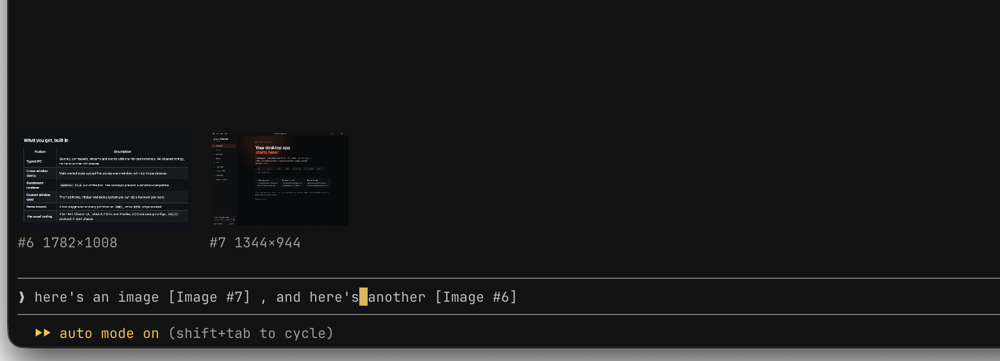

# cc-paste-thumbnails

A [Claude Code](https://claude.com/claude-code) plugin that shows images you paste into the prompt as thumbnails above it, labeled `#N` with their resolution so they match the `[Image #N]` placeholders. Delete a placeholder and its thumbnail goes away; submit and the row clears.



## Install

```sh
claude plugin marketplace add guasam/claude-plugins
claude plugin install cc-paste-thumbnails@guasam
```

## Notes

- macOS and Linux. Reads the clipboard with `osascript` on macOS, and `wl-paste` (Wayland) or `xclip` (X11) on Linux
- Real thumbnails need a terminal with the kitty graphics protocol (Ghostty, kitty). Other terminals and the desktop app show text chips instead.
- Built on Claude Code's early-access plugin API, which may change between releases.

## Development

```sh
claude plugin validate .
claude plugin test .
```

To load a local checkout in every session, add its path to `CLAUDE_CODE_PLUGIN_DIRS` under `env` in `~/.claude/settings.json`. Edits then reload live.

## License

MIT
